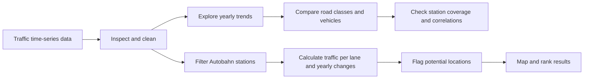

<div align="center">

# 🇩🇪 German Road Traffic Data Analysis

### A university subject project exploring 20 years of German road traffic data

**Python · Data Analytics · Visualization · Exploratory Analysis**


</div>

---

## 👋 About the project

This university subject project uses Python to explore German road traffic counting data from **2003 to 2023**. In a Jupyter Notebook, I investigate long-term traffic patterns, compare Autobahns and Bundesstraßen, examine vehicle categories, and explore how station coverage can affect year-to-year comparisons.

The notebook also includes a map-based exploration of potential Autobahn bottlenecks using traffic counts and station-level changes. The analysis is designed to make the data and reasoning visible, from initial data checks through charts and interpretation.

## 🧭 Analysis at a glance



## 🔎 What I investigated

| Topic | Analysis |
|---|---|
| 📈 Long-term trends | Yearly median daily traffic and percentage changes |
| 🛣️ Road classes | Autobahn (A) compared with Bundesstraße (B) |
| 🚚 Vehicle mix | Heavy-vehicle measures and selected vehicle categories |
| 📍 Station coverage | How changes in observed stations affect aggregate comparisons |
| 🚦 Potential bottlenecks | High traffic per lane and unusually large local declines |
| 📊 Communication | Charts, a multi-chart dashboard, correlation heatmap, and map |

## 💡 Example finding: the 2013–2014 jump

The national median daily traffic increased by **5,737 vehicles** between 2013 and 2014. Over the same period, the number of counting stations grew from **1,503 to 1,683**. When the comparison was restricted to stations observed in both years, the increase fell to **1,623 vehicles**.

This suggests that the changing mix of stations accounts for a substantial part of the apparent jump. It does not, by itself, establish the cause of every traffic change.

## 🗺️ Exploring potential Autobahn bottlenecks

The notebook uses two data-based indicators to highlight stations for further investigation:

- **High traffic per lane:** flags stations in the busiest 10% by daily traffic divided by lane count.
- **Unusually large local decline:** flags a station when its year-on-year traffic drop is at least 15 percentage points greater than the national median change for that year. This helps distinguish a local drop from a broad nationwide change, such as the 2020 decline.

In the saved notebook outputs, these rules flagged **125 high-load stations** and **46 stations with unusually large declines**. A map and road-level ranking visualize the flagged locations.

> These are exploratory indicators based on thresholds selected for the project. They identify potential locations for investigation; they do not confirm actual traffic jams or construction sites.

## 🧰 Tools and methods

- **Python** — analysis workflow
- **pandas** — data loading, cleaning, grouping, and reshaping
- **Matplotlib** and **Seaborn** — charts, dashboard, and correlation heatmap
- **Jupyter Notebook** — step-by-step analysis and documentation
- Descriptive statistics, medians, percentage changes, correlations, and station-level comparisons
- **GeoJSON** outline data for mapping locations in Germany

## 📂 Repository contents

- `SoSe_2026_PRS_Gohil_Ramani_topic_9.ipynb` — analysis notebook, visualizations, and AI assistance declarations
- `Zeitreihe.csv` — required input data, if redistribution is permitted
- `germany_outline.geojson` — optional cached map outline; the notebook can attempt to download it if missing

> The notebook expects `Zeitreihe.csv` in its working directory. The copy I reviewed did not include the CSV. Add it only if you have permission to share it; otherwise, document the original data source and access steps here.

## ▶️ Run the notebook

1. Install Python and Jupyter Notebook or JupyterLab.
2. Install the required libraries:

   ```bash
   pip install pandas matplotlib seaborn
   ```

3. Place `Zeitreihe.csv` in the same working directory as the notebook.
4. Open `SoSe_2026_PRS_Gohil_Ramani_topic_9.ipynb` and run the cells in order.

The map section uses Python standard-library modules (`json`, `os`, and `urllib.request`). If the Germany outline is not already saved locally, fetching it requires an internet connection.

## ⚖️ Interpretation and limitations

- The 90th-percentile and 15-percentage-point cutoffs are project heuristics, not official definitions of congestion or roadworks.
- Counting-station coverage changes over time, and missing-value rates vary by year. Aggregate comparisons should be interpreted with care.
- Correlations describe relationships in this dataset; they do not establish causation.
- A traffic count alone cannot explain why traffic changed. Network coverage, measurement changes, road works, and other factors may contribute.
- Map results depend on the completeness and accuracy of the traffic and coordinate data.

## 🤖 AI assistance and academic transparency

The notebook includes detailed AI assistance declarations. They record ChatGPT assistance for selected visualizations and analysis implementation in Task 1, and Claude assistance for the construction-decline detector and Germany-outline loading in Task 2. The declarations also describe which parts were completed or understood by the student. Please refer to those notebook sections for the full attribution.

---

<div align="center">

**University subject project · Data analysis with Python · 2003–2023**

</div>
